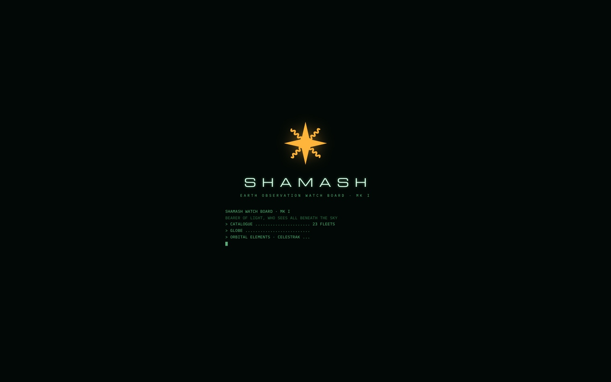
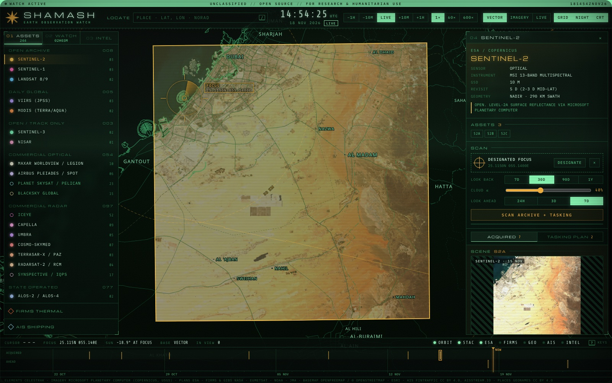
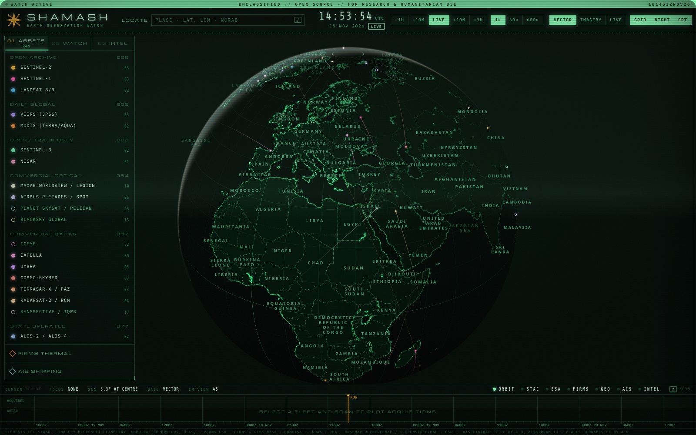
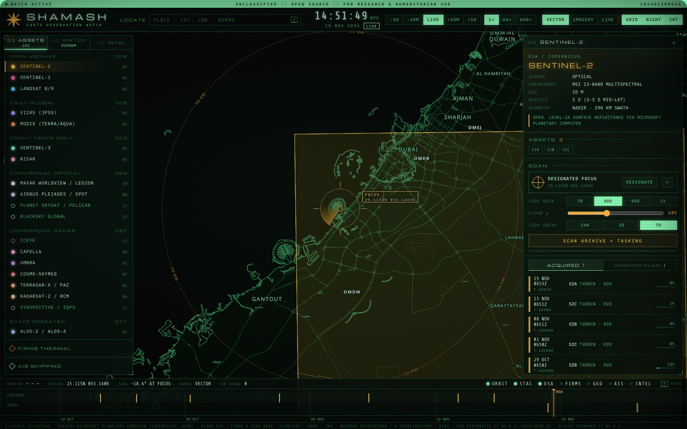
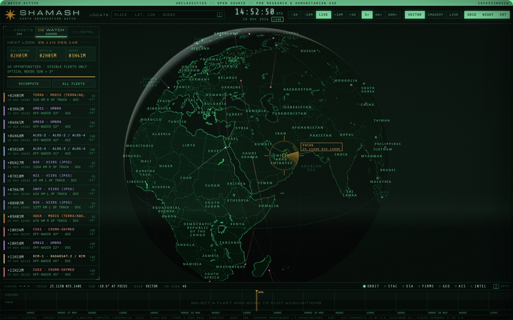
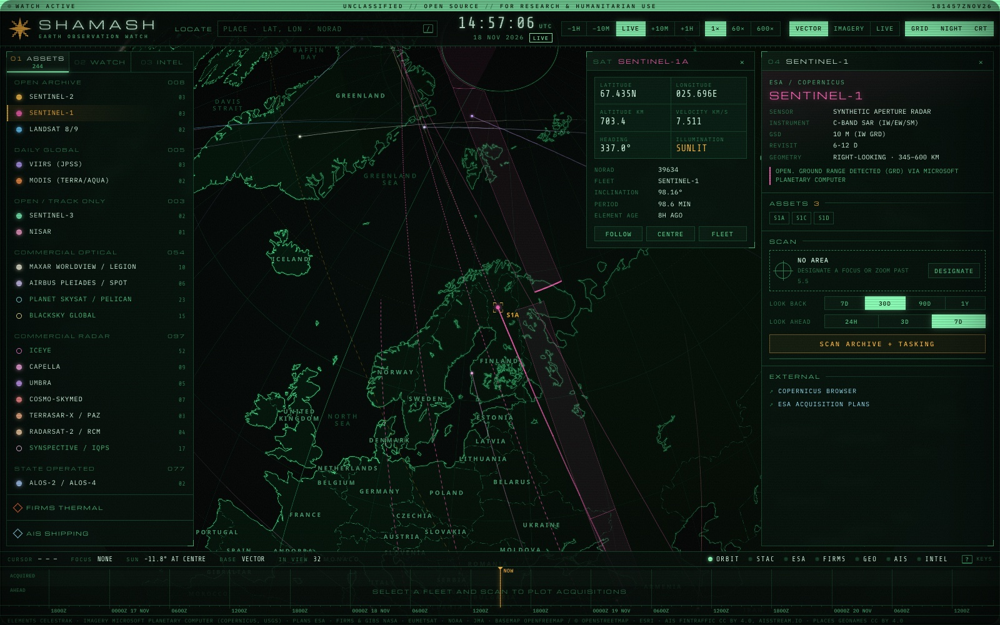
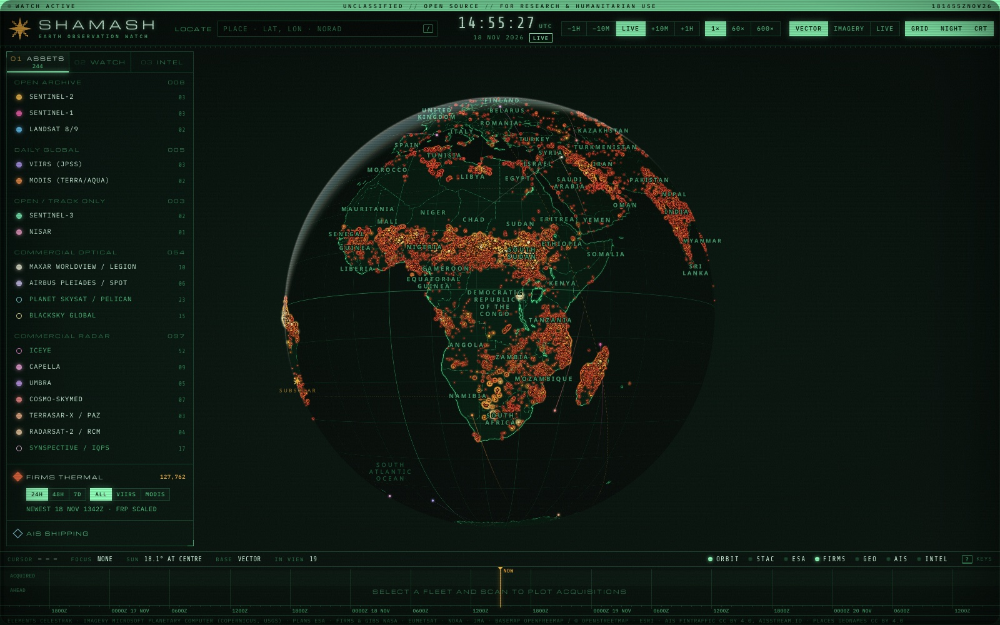
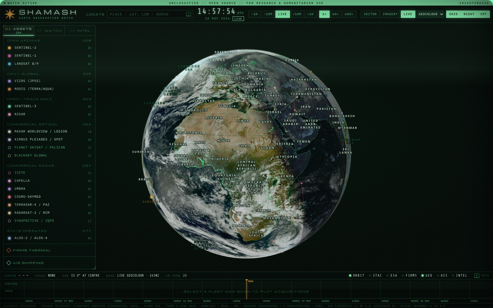
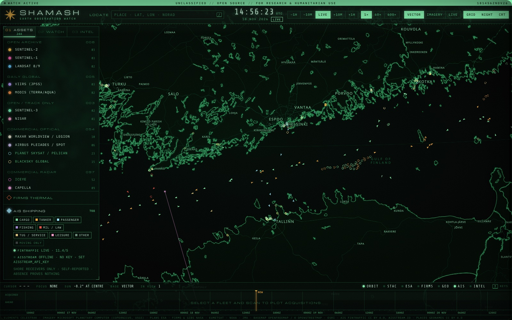
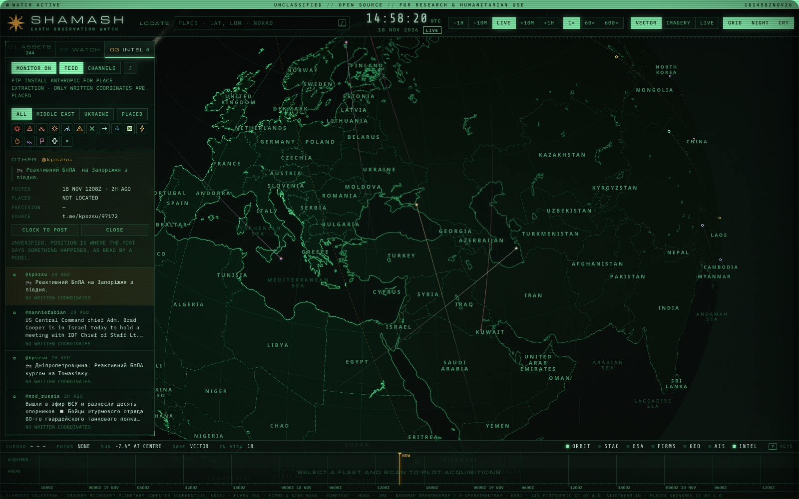

<div align="center">



# SHAMASH

**An earth-observation watch board for your own machine.**

Which imaging satellites are overhead right now, what they have already photographed over a place,
and when the next one will look. Drawn as a Cold War vector situation display.

Python standard library · plain ES modules · no build step · no accounts needed for the core features

</div>

---



Shamash is named for the Mesopotamian sun god, who crossed the sky each day and saw everything
beneath it. It puts a few hundred imaging satellites on a live globe, alongside free
imagery archives, operator tasking plans, fire detections, ship positions, geostationary weather
imagery and open-source reports. You can see them all on one map and on one clock.

## Contents

- [What it does](#what-it-does)
- [Use cases](#use-cases)
- [Screenshots](#screenshots)
- [Quick start](#quick-start)
- [Using the board](#using-the-board)
- [Data sources](#data-sources)
- [Limits](#limits)
- [How it is built](#how-it-is-built)
- [Credits and licence](#credits-and-licence)

## What it does

| | |
| --- | --- |
| **Live satellite tracking** | 23 imaging fleets (Sentinel, Landsat, Maxar, Planet, ICEYE, Capella, Umbra and more), propagated with SGP4 from CelesTrak elements. Each satellite has its swath footprint, ground track and a fading phosphor trail |
| **Archive search** | Designate a place and scan the Sentinel-2, Sentinel-1 and Landsat archives on Microsoft Planetary Computer, filtered by look-back window and cloud cover |
| **Tasking ahead** | ESA's published Sentinel acquisition plans, plus SGP4 pass prediction for every other fleet |
| **Imagery on the globe** | Open any scene for a quicklook, pick a visualisation (true colour, short-wave infrared through smoke, NDVI, burn ratio, radar polarisations…), render up to six scenes on the globe, or download bands as GeoTIFF |
| **WATCH board** | Every visible fleet that can image your focus point in the next 48 hours, soonest first, with the next optical and next radar look summarised |
| **Fire detections** | NASA FIRMS VIIRS and MODIS hotspots (24 h / 48 h / 7 d), scaled by radiative power |
| **Live weather view** | The newest full-disc geostationary imagery (Meteosat, GOES, Himawari) stitched around the globe |
| **Ships** | AIS positions from Fintraffic (Baltic, no key) and, with a free key, worldwide from aisstream.io |
| **Intel feed** | Public Telegram channels read into a local store and placed on the map, with optional place extraction by Claude |
| **Time control** | Run the board clock forward or back at up to 600×, or jump straight to any predicted pass |
| **Shareable views** | The address bar keeps the view, fleet, focus, basemap and clock, so you can send someone a link |

## Use cases

**Humanitarian and disaster response.** Check whether fresh, cloud-free imagery exists over a flood,
earthquake or fire zone. If it doesn't, see exactly when the next optical or radar satellite passes.
Lay FIRMS fire detections over the same area to see where burning is active now.

**Open-source investigation and journalism.** Verify a claimed event against the imagery timeline.
Was there a satellite overhead, was it cloudy, and is there a free scene from before and after?
The Intel tab puts public channel reports on the same map and clock as the satellites.

**Research and teaching.** Show students how sun-synchronous orbits, swath width, revisit time and
radar-versus-optical trade-offs work, with real satellites moving on a real globe. Run the clock at
600× and watch the ground tracks build up.

**Planning image requests.** Before you buy commercial imagery or put in a tasking request, see
which constellations can reach the site, at what off-nadir angle, and with what sun elevation.

**Maritime awareness.** Watch ship traffic near ports and chokepoints. Then designate a ship as the
focus to see which satellites will pass over it next.

**Environmental monitoring.** Track burn scars, crop health (NDVI) and coastline change using the
free Sentinel-2 and Landsat archives. No GIS software needed.

## Screenshots

<table>
<tr>
<td width="50%"><br><b>The board.</b> Every visible fleet live on the globe, with day/night shading and phosphor trails.</td>
<td width="50%"><br><b>Scan.</b> Sentinel-2 archive and ESA tasking plan for a focus point over Dubai, plotted on the timeline below.</td>
</tr>
<tr>
<td><br><b>WATCH.</b> 60 imaging opportunities over the next 48 hours, soonest first.</td>
<td><br><b>Satellite card.</b> Sentinel-1A's position, altitude, velocity, illumination and radar swath.</td>
</tr>
<tr>
<td><br><b>FIRMS.</b> About 128,000 thermal detections from the last 24 hours, sized by fire radiative power.</td>
<td><br><b>LIVE.</b> The newest geostationary GeoColour mosaic wrapped onto the globe.</td>
</tr>
<tr>
<td><br><b>AIS.</b> About 700 ships in the Gulf of Finland, coloured by vessel type.</td>
<td><br><b>INTEL.</b> Public Telegram channels in one feed, placed on the map when a location can be read.</td>
</tr>
</table>

## Quick start

Needs Python 3.9 or newer and a browser with WebGL.

```sh
git clone https://github.com/danialharizwong/shamash.git
cd shamash
./run.sh
```

Then open <http://localhost:8700/>.

The first start takes about 20 seconds while orbital elements download. After that they are cached for 3 hours.

| Option | Default | Meaning |
| --- | --- | --- |
| `--port` | `8700` | Port to serve on |
| `--host` | `127.0.0.1` | Interface to bind. There is no access control, so keep it local |
| `--intel-budget` | `0.50` | Daily cap in USD for Intel place extraction |

### Optional extras

```sh
python3 -m venv .venv && .venv/bin/pip install -r requirements.txt
```

`run.sh` uses `.venv` automatically when it exists.

| Feature | Needs |
| --- | --- |
| Intel place extraction | `anthropic` package plus `ANTHROPIC_API_KEY` |
| Worldwide AIS | `websockets` package plus a free `AISSTREAM_API_KEY` from [aisstream.io](https://aisstream.io) |

Everything else, including Baltic AIS from Fintraffic, works with the standard library alone.

## Using the board

| Area | What it does |
| --- | --- |
| **01 ASSETS** | 23 imaging fleets in six groups. The lamp shows or hides a fleet, and the name selects it. The FIRMS and AIS overlay switches are below |
| **02 WATCH** | Designate a focus and every visible fleet is checked over the next 48 hours |
| **03 INTEL** | Public Telegram channels placed on the map. These are unverified reports |
| **04 MISSION** | The selected fleet: specs, satellites, scan controls, results and scene detail |
| **Timeline** | Acquired scenes above the line, tasking and predicted passes below. Scroll to zoom, drag to pan, double-click to reset |
| **Readout bar** | Cursor, focus, sun elevation, basemap, satellites in view and data-link lamps (hover for detail) |

**A typical session.**
1. Press `/` and type a place, a `lat, lon`, or a satellite name or NORAD number. Or press `D` and click the globe.
2. Select a fleet and press **SCAN**.
3. Open a scene for its quicklook, pick a visualisation and choose **RENDER ON BOARD**.
4. For a future pass, choose **RUN CLOCK TO PASS** to watch it happen.

**Keys.** `D` designate · `Esc` cancel/close · `L` live clock · `[` `]` clock rate · `F` follow satellite ·
`/` locate · `G` `N` `C` grid/night/CRT · `1` `2` `3` tabs · `?` key card.

## Data sources

| Data | Source |
| --- | --- |
| Orbital elements | CelesTrak GP (cached 3 h) |
| Scenes, tiles, downloads | Microsoft Planetary Computer (Sentinel-2 L2A, Sentinel-1 GRD, Landsat C2 L2) |
| Tasking plans | ESA Sentinel acquisition plan KML |
| Daily mosaics, GOES, Himawari | NASA GIBS |
| Fire detections | NASA FIRMS near-real-time (cached 20 min) |
| Meteosat and geo-ring mosaics | EUMETSAT EUMETView |
| Basemap | OpenFreeMap / OpenMapTiles / © OpenStreetMap contributors; Esri World Imagery |
| Place search | OpenStreetMap Nominatim |
| Ships | Fintraffic Digitraffic (CC BY 4.0); aisstream.io |
| Intel | Public Telegram previews (`t.me/s/<channel>`); GeoNames (CC BY 4.0); Anthropic API |

Each provider's terms apply to its own data.

## Limits

- Predicted passes for commercial, steerable satellites are **opportunities**. They show when a
  satellite *could* image a place, not whether it has been tasked to.
- AIS comes only from shore receivers and is self-reported. A ship missing from the map proves nothing.
- Intel reports are unverified. A dashed ring means the place could only be pinned to an area, or
  is the model's own estimate.
- There are no accounts or access control. Keep the server bound to `127.0.0.1`.

## How it is built

A small Python relay server (standard library only) handles the requests a browser can't make directly. A browser
page draws everything else with MapLibre GL's globe projection and satellite.js.

```
server.py       relay: elements, plans, FIRMS, geostationary frame times, downloads
ais.py          ship feeds merged into one store
intel.py        Telegram reader, post store, gazetteer, place extraction
web/index.html  page shell
web/css/        shamash.css (the whole visual system)
web/js/         plain ES modules, no bundler
  main.js boot · state.js clock + bus · map.js globe + layers · style.js phosphor basemap
  orbit.js SGP4, swaths, access windows · board.js per-frame plotting · ui.js header, roster, cards
  scan.js archive / plans / prediction / visualisations · mission.js right panel · timeline.js
  watch.js next-look board · firms.js · live.js · ais.js · intel.js · util.js
web/vendor/     MapLibre GL JS, satellite.js, fonts (licences in web/vendor/licenses)
```

**Design.** The look is a P1 green-phosphor vector display:
- Coastlines drawn twice, a blurred bloom under a crisp trace, like a phosphor beam.
- Scanlines, a slow rolling refresh bar, grain and a curved-glass vignette. All of these switch off with `CRT`.
- Gold, for the sun god, marks anything you command: your focus point, selections and the clock.
- Type is Michroma for headings, IBM Plex Mono for text and Share Tech Mono for numbers.

**Changes from Cheyenne**
- The WATCH next-look board.
- Persistence trails.
- Twilight bands and a sub-solar marker.
- Himawari in the LIVE view.
- Range rings and a sweeping reticle at the focus.
- Satellite search by name or NORAD number.
- Degrees-minutes-seconds input in the locator.
- IPv4-first networking: on networks with broken IPv6, downloads that took minutes now take seconds.
- A faster boot.
- Ship flags looked up from the radio ID (MMSI).

## Credits and licence

Inspired by [Cheyenne](https://github.com/MJCruickshank/cheyenne) by M. J. Cruickshank. Shamash
uses the same public data sources, but its code is a new implementation.

Shamash is released under the [MIT licence](LICENSE). The bundled libraries and fonts keep their own
licences: MapLibre GL JS (BSD-3-Clause), satellite.js (MIT), and IBM Plex Mono, Share Tech Mono and
Michroma (SIL OFL 1.1). Their licence texts are in [`web/vendor/licenses`](web/vendor/licenses).
